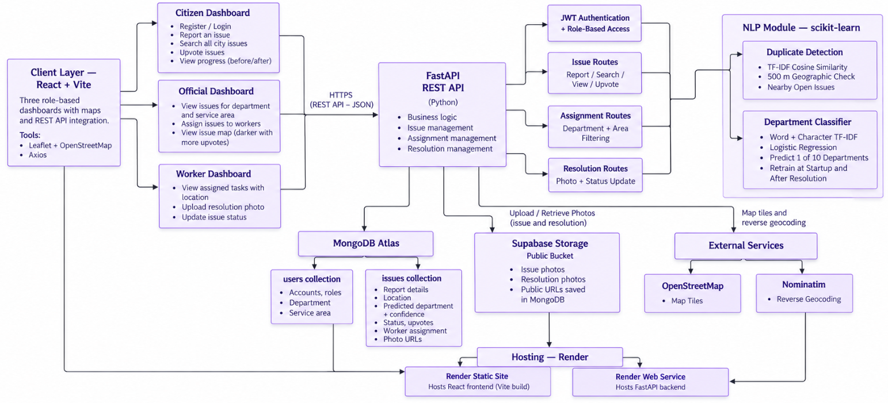

# Fixora

**A smart city starts with smart fixes.**

Fixora is a civic issue reporting platform. Citizens report problems in their city, the system automatically sends each report to the right department using NLP, officials assign the work to field workers, and workers upload a photo once the issue is fixed.

---

## Architecture



---

## Features

**Citizen**
- Report an issue with a title, description, photo and map location (starts at your current location)
- Track progress from reported to resolved, and see the before and after photos
- Search issues across the city by name or address, and upvote them

**Official**
- See every issue for their department and service area
- Assign issues to workers of the same department and area
- Map where markers get darker as upvotes increase

**Worker**
- See assigned tasks with the issue location
- Upload a photo of the fixed issue

---

## NLP

| Task | Approach |
|---|---|
| Department routing | TF-IDF (words and character n-grams) with Logistic Regression, predicting 1 of 10 departments. No department picker for the citizen. |
| Duplicate detection | TF-IDF cosine similarity plus a 500 m distance check, so citizens can upvote an existing issue instead of filing a copy. |
| Self-improving | The model retrains from resolved issues at server start and after each resolution. |

Training examples are in `backend/app/nlp_seed.py`. Add more examples there to improve accuracy.

**Departments:** Road, Transport, Water, Waste, Electricity, Public Safety, Parks and Recreation, Drainage and Sewerage, Street Lighting, Public Buildings.

---

## Tech stack

| Layer | Technology |
|---|---|
| Frontend | React, Vite, Leaflet, Axios |
| Backend | FastAPI, JWT authentication, role-based access |
| NLP | scikit-learn (TF-IDF, Logistic Regression) |
| Database | MongoDB Atlas |
| Storage | Supabase Storage |
| Hosting | Render |

---

## Run locally

**Requirements:** Python 3.11, Node.js 20, a MongoDB Atlas cluster, and a Supabase project with a public storage bucket.

### 1. Backend

```bash
cd backend
python -m venv .venv
source .venv/bin/activate        # Windows: .venv\Scripts\activate
pip install -r requirements.txt
cp .env.example .env             # then fill in the values
uvicorn app.main:app --reload --port 8000
```

### 2. Frontend

```bash
cd frontend
npm install
echo "VITE_API_URL=http://127.0.0.1:8000" > .env
npm run dev
```

Open `http://localhost:5173`.

---

## Environment variables

**backend/.env**

| Variable | Purpose |
|---|---|
| `MONGODB_URL` | MongoDB Atlas connection string |
| `MONGODB_DATABASE` | Database name |
| `JWT_SECRET_KEY` | Secret used to sign login tokens |
| `JWT_EXPIRE_HOURS` | Token lifetime |
| `CORS_ORIGINS` | Frontend URL(s), comma separated |
| `SUPABASE_URL` | Supabase project URL |
| `SUPABASE_SERVICE_ROLE_KEY` | Supabase service role key (server only) |
| `SUPABASE_BUCKET` | Public bucket name for photos |
| `DUPLICATE_TEXT_THRESHOLD` | Minimum text similarity for duplicates (default 0.40) |
| `DUPLICATE_RADIUS_METERS` | Search radius for duplicates (default 500) |

**frontend/.env**

| Variable | Purpose |
|---|---|
| `VITE_API_URL` | Backend URL, without a trailing slash |

Never commit `.env` files. They are already in `.gitignore`.

---

## Real-world impact

- **Faster reporting:** citizens describe the problem once and never need to know which department handles it.
- **Less misrouted work:** NLP sends each report to the right team, so issues are not passed between offices.
- **No duplicate effort:** nearby similar reports are caught early, and upvotes show what the community cares about most.
- **Clear priorities:** officials see where problems cluster and which ones have the most support.
- **Accountability:** every issue has a visible status, an assigned worker and a before and after photo.
- **Local ownership:** officials and workers handle only the issues in their own department and area.

> *A city is only as smart as the speed at which it listens and fixes.*
